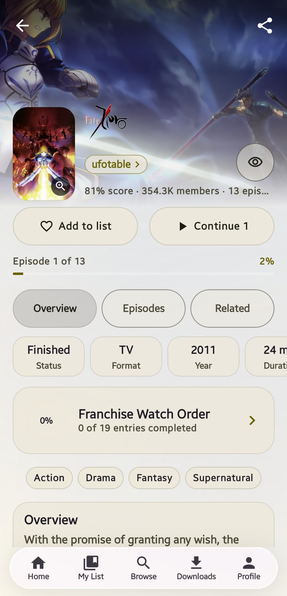
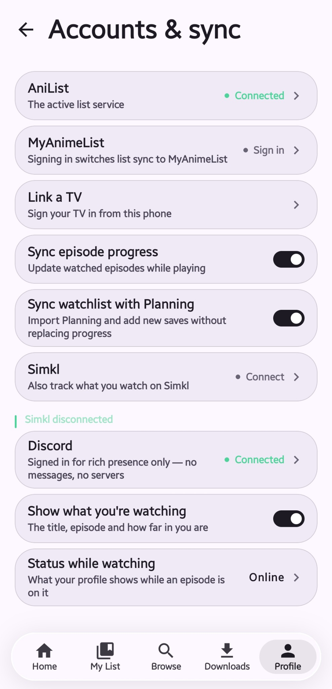
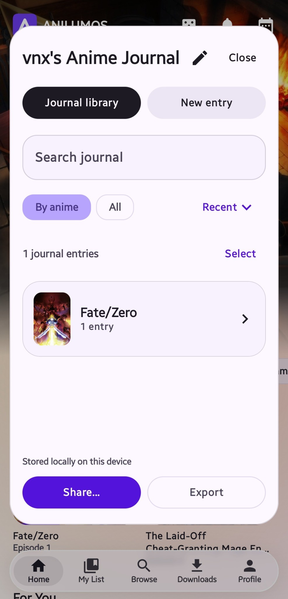
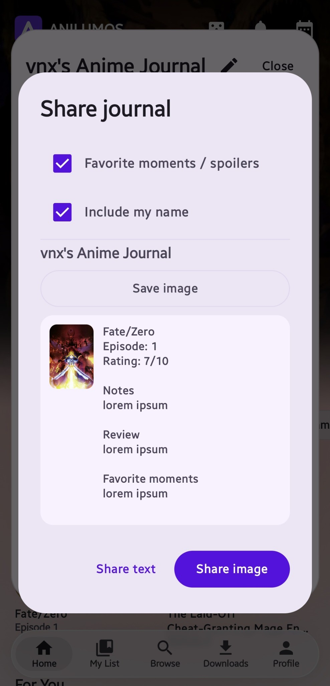
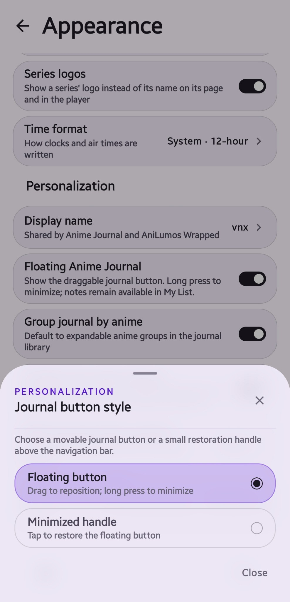

<div align="center">
  

  # AniLumos

  An anime app for Android phones and tablets, based on [AniLife](https://github.com/anilifecommunity/android-and-tv), with a redesigned Glass UI, personalised discovery and cinematic playback.

  [Download APK](https://github.com/vnxrgb/Anilumos/releases/latest) · [All releases](https://github.com/vnxrgb/Anilumos/releases) · [Report a bug](https://github.com/vnxrgb/Anilumos/issues)
</div>

<p align="center">
  <a href="https://github.com/vnxrgb/Anilumos/releases/latest"></a>
  <a href="https://github.com/vnxrgb/Anilumos/releases"></a>
  <a href="https://github.com/vnxrgb/Anilumos/stargazers"></a>
</p>

## About AniLumos

AniLumos builds on AniLife with its own visual identity, a redesigned interface and an emphasis on discovery, playback and everyday usability.

## What makes AniLumos different?

AniLumos is built on [AniLife](https://github.com/anilifecommunity/android-and-tv). The following separates additions made in this fork from enhancements to features already provided by upstream.

### New AniLumos features

| Feature | What's different |
| --- | --- |
| **Optical Glass UI** | Translucent navigation, cards, dialogs and controls, with customizable glass material presets. |
| **Ambient Cinema** | Video-reactive ambient lighting using adapted Morphe code, integrated into the built-in player. |
| **Ambient Home & details** | Artwork-driven background colors and transitions on Home and anime details. |
| **Mood Discovery** | Choose a mood and swipe through matching anime suggestions. |
| **Anime Journal** | Private on-device anime and episode notes, reviews, ratings and favorite moments; searchable, sortable and grouped entries with multi-select and text or artwork-based image sharing. |
| **Journal personalization** | Draggable floating journal or minimized handle, a permanent My List shortcut, shared display name and optional name inclusion in shares. |
| **AniLumos Wrapped** | Viewing statistics and artwork-based shareable summaries, with a shared customizable display name. |
| **Curated franchise guides** | Dedicated Franchise Watch Order screen with chronological, recommended and alternative routes where available, timeline/list views, completion tracking and next unfinished anime. |
| **Metadata diagnostics** | Inspect metadata availability and troubleshoot community service failures. |

### Improved AniLife features

| Feature | What's different |
| --- | --- |
| **Personalized recommendations** | Hybrid ranking combines viewing preferences with AniList and additional community metadata. |
| **Skip intro/outro** | Redesigned timed, dismissing skip buttons and additional timestamp sources where available. |
| **Episode classifications** | Expands basic filler flags to canon, mixed, anime canon and recap labels, plus optional filler filtering and skipping. |
| **Player controls** | Rounded glass playback controls, refined seekbar layout and panels. |
| **Navigation and screens** | Floating glass navigation, redesigned Home, details, search, settings and dialogs. |
| **Appearance and accessibility** | Glass material choices, custom background readability and artwork-aware status bar contrast. |
| **Adaptive layouts** | Improved phone/tablet landscape navigation and discovery layouts. |
| **Guided tour** | Expanded the existing What's New walkthrough to cover the franchise guide, Anime Journal and personalization. |
| **In-app updates** | Uses AniLumos's own GitHub stable releases and verifies downloaded APKs before installation. |

### Additional integrations

| Source | Purpose |
| --- | --- |
| [Anime Watch Order API](https://github.com/Bas1874/Anime-Watch-Order-Api) | Community watch-order routes, based on the r/anime wiki. |
| [Anime Metadata DB](https://github.com/michael-freling/anime-metadata-db) | Chronological and alternative franchise routes (ODbL / DbCL). |
| [Tenrai](https://tenrai.org/) | Community recommendations and episode flags. |
| [TheIntroDB](https://theintrodb.org/) | Additional segment timestamps. |
| [IntroDB](https://introdb.app/) | Additional segment timestamps. |
| [FillerLists](https://fillerlists.com/data) | Episode classifications. |
| [AniFillerPedia](https://anifillerpedia.wiki/) | Additional episode classifications. |
| [Morphe](https://morphe.software) | Adapted ambient-lighting code. |

AniSkip and the original recommendation and franchise-list foundations already existed in AniLife. Availability of curated routes, timestamps and classifications varies by anime and service.

### Core features inherited from AniLife

AniList, MyAnimeList and Simkl accounts; Discord Rich Presence; downloads and offline playback; watch history and Continue Watching; anime search, browsing, genres, airing schedule and notifications; subtitles, external players, picture-in-picture, gestures and screen lock; profile PINs; and phone/tablet layout foundations.

Stable AniLumos releases are for Android phones and tablets; TV previews are experimental. AniLumos has its own branding, application ID, signed releases, website and Orion Store listing. See [upstream provider sync documentation](docs/UPSTREAM_PROVIDER_SYNC.md) for how upstream changes are tracked and reviewed.

## Screenshots

A look at AniLumos on Android, including the Anime Journal and its personalization and sharing options.

<p align="center">
  <a href="docs/store/screenshots/01-home.jpg"></a>
  <a href="docs/store/screenshots/02-anime-details.jpg"></a>
  <a href="docs/store/screenshots/franchise-watch-order-entry.jpg"></a>
  <a href="docs/store/screenshots/franchise-watch-order-screen.jpg"></a>
</p>
<p align="center">Home and Glass UI · Anime details · Franchise guide entry · Franchise watch order</p>

<p align="center">
  <a href="docs/store/screenshots/03-player.jpg"></a>
  <a href="docs/store/screenshots/04-discover.jpg"></a>
  <a href="docs/store/screenshots/05-notifications.jpg"></a>
</p>
<p align="center">Ambient player and Skip Intro · Mood-based Discover · Notifications</p>

<p align="center">
  <a href="docs/store/screenshots/06-schedule.jpg"></a>
  <a href="docs/store/screenshots/07-accounts.jpg"></a>
  <a href="docs/store/screenshots/08-appearance.jpg"></a>
</p>
<p align="center">Airing schedule · Accounts and integrations · Appearance and themes</p>

<p align="center">
  <a href="docs/store/screenshots/journal-library.jpg"></a>
  <a href="docs/store/screenshots/journal-share.jpg"></a>
  <a href="docs/store/screenshots/journal-personalization.jpg"></a>
</p>
<p align="center">Anime Journal library · Journal image sharing · Journal personalization</p>

## Download

Grab the [latest stable APK](https://github.com/vnxrgb/Anilumos/releases/latest) from GitHub, or find the app on Orion Store.

<p align="center">
  <a href="https://rookieenough.github.io/Orion-Data/app/?id=anilumos"></a>
</p>

The stable app uses `com.anilumos.app`. Some signed preview builds use the same package and may replace an installed stable build; check the release notes before installing. AniLife keeps its own app data.

Stable releases are intended for Android phones and tablets. Android TV builds are experimental and are not part of this stable mobile release.

## Building it yourself

You'll need JDK 17, Android SDK 36 and the Gradle wrapper included in this repository.

```bash
./gradlew :app:testMobileDebugUnitTest :app:lintMobileDebug :app:assembleMobileDebug
```

## Credits and licenses

**Anilumos is a fork, not an app built from scratch.** Most of the underlying functionality comes from [AniLife](https://github.com/anilifecommunity/android-and-tv), and credit for that belongs to the [AniLife contributors](https://github.com/anilifecommunity/android-and-tv/graphs/contributors).

Ambient lighting uses adapted code from [Morphe](https://github.com/MorpheApp/morphe-patches). You can read the [implementation notes](docs/MORPHE_AMBIENT_PORT.md).

Other libraries used in the app include [AndroidX / Jetpack Compose / Media3](https://github.com/androidx/androidx), [Haze](https://github.com/chrisbanes/haze), [Coil](https://github.com/coil-kt/coil), [OkHttp](https://github.com/square/okhttp), [Okio](https://github.com/square/okio), [MaterialKolor](https://github.com/jordond/MaterialKolor), and [Nayuki's QR Code generator](https://github.com/nayuki/QR-Code-generator).

**Required Morphe notice:**

> This app uses code from Morphe. To learn more, visit https://morphe.software

The [AniLife Source-Available License 1.0](LICENSE) is retained. Redistribution of modified AniLife code requires permission; the maintainer has stated that permission was obtained. Morphe-derived code has separate [GPLv3](app/src/main/assets/GPL-3.0.txt) obligations and a [required notice](app/src/main/assets/MORPHE_NOTICE.txt). See [asset licenses](docs/ASSET-LICENCES.md) for additional details.

Anilumos isn't affiliated with or endorsed by AniLife or Morphe. It doesn't host anime streams or own third-party content.

---

[Privacy](PRIVACY.md) · [Security](SECURITY.md) · [Support](SUPPORT.md)


### Original AniLumos contributions

Copyright © 2026 [vnxrgb](https://github.com/vnxrgb).

This notice applies only to original contributions owned by the AniLumos maintainer, such as independently created branding, visual assets, UI work, and code changes. It does not claim ownership of underlying AniLife code, Morphe-derived work, or third-party materials. Their existing licenses, attribution requirements, and permissions remain in effect.

### Community playback metadata

- [Tenrai](https://tenrai.org/) — unofficial public MAL episode flags and community recommendations, using its documented v1 API. Replaces the discontinued public Jikan API. No API key is embedded; public request limits and cooldowns are respected. See [Tenrai terms](https://tenrai.org/terms).

- [AniSkip](https://github.com/aniskip/aniskip-api) — anime intro, ending and recap timestamps.
- [TheIntroDB](https://theintrodb.org/) — community segment timestamps.
- [IntroDB](https://introdb.app/) — community segment timestamps, [ODbL 1.0 open data](https://api.introdb.app/open-data/).
- Anime filler data from [FillerLists and its sources](https://fillerlists.com/data), [CC BY-SA 4.0](https://creativecommons.org/licenses/by-sa/4.0/). The app retains episode numbers and explicit classifications (filler, canon, mixed and anime canon), with the source data available under the same CC BY-SA 4.0 license.
- [AniFillerPedia](https://anifillerpedia.wiki/) — cited episode classifications for non-commercial use under its [data license](https://anifillerpedia.wiki/api/v1/license). Explicit episode classifications are cached for non-commercial use; the original data and its licensing terms remain available at the source.

These optional read-only providers need no user credentials. Unknown or mixed episodes are not treated as filler merely because a lookup returned no classification.
