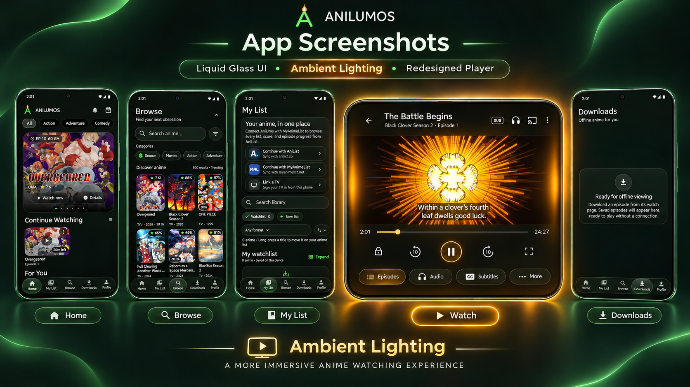

<div align="center">
  

  # Anilumos

  An anime app for Android, based on [AniLife](https://github.com/anilifecommunity/android-and-tv), with a new look and a reworked video player.

  [Download APK](https://github.com/vnxrgb/Anilumos/releases/latest) · [All releases](https://github.com/vnxrgb/Anilumos/releases) · [Report a bug](https://github.com/vnxrgb/Anilumos/issues)
</div>

<p align="center">
  <a href="https://github.com/vnxrgb/Anilumos/releases/latest"></a>
  <a href="https://github.com/vnxrgb/Anilumos/releases"></a>
  <a href="https://github.com/vnxrgb/Anilumos/stargazers"></a>
</p>

## Why this fork?

I liked what AniLife offered, but wanted to try a different design. Anilumos started with that idea: keep the anime features I already liked, clean up the interface, and make watching something feel a bit nicer.

The biggest changes are the glass-style UI and the video player. I also added ambient lighting around the video, based on code from [Morphe](https://github.com/MorpheApp/morphe-patches).

## What's different?

- **Glass UI:** Translucent navigation, cards, menus and buttons, with a neutral look that works with different themes.
- **Video player:** Rounder controls, updated seek bar and overlays, and changes to the mini-player.
- **Ambient lighting:** Colors from the video glow around the player. Results can vary depending on the device.
- **New branding:** Anilumos icon, launch screen and app name.

The original AniLife features are still here, including anime search and browsing, streaming sources, watch history, downloads, subtitles, external players, and AniList/MyAnimeList support.

I've also set up a way to track streaming-provider changes from upstream. Those changes still need review and a new app release before they reach installed versions. More on that [here](docs/UPSTREAM_PROVIDER_SYNC.md).

## Screenshots

<p align="center">
  <a href="docs/store/screenshots/01-home.jpg"></a>
  <a href="docs/store/screenshots/02-my-list.jpg"></a>
  <a href="docs/store/screenshots/03-browse.jpg"></a>
  <a href="docs/store/screenshots/04-anime-details.jpg"></a>
  <a href="docs/store/screenshots/05-episode-playback.jpg"></a>
</p>

## Download

Grab the [latest stable APK](https://github.com/vnxrgb/Anilumos/releases/latest) from GitHub, or find the app on Orion Store.

<p align="center">
  <a href="https://rookieenough.github.io/Orion-Data/app/?id=anilumos"></a>
</p>

The stable app uses `com.anilumos.app`. [Preview builds](https://github.com/vnxrgb/Anilumos/releases/tag/anilumos-preview) use `com.anilumos.app.debug`, so they can be installed separately. AniLife also keeps its own app data.

Anilumos is currently intended for Android phones and tablets. I haven't verified a separate TV release.

## Building it yourself

You'll need JDK 17, Android SDK 36 and the Gradle wrapper included in this repository.

```bash
./gradlew :app:testMobileDebugUnitTest :app:lintMobileDebug :app:assembleMobileDebug
```

## Credits and licenses

**Anilumos is a fork, not an app built from scratch.** Most of the underlying functionality comes from [AniLife](https://github.com/anilifecommunity/android-and-tv), and credit for that belongs to the [AniLife contributors](https://github.com/anilifecommunity/android-and-tv/graphs/contributors).

Ambient lighting uses adapted code from [Morphe](https://github.com/MorpheApp/morphe-patches). You can read the [implementation notes](docs/MORPHE_AMBIENT_PORT.md).

Other libraries used in the app include [AndroidX / Jetpack Compose / Media3](https://github.com/androidx/androidx), [Haze](https://github.com/chrisbanes/haze), [Coil](https://github.com/coil-kt/coil), [OkHttp](https://github.com/square/okhttp), [Okio](https://github.com/square/okio), [MaterialKolor](https://github.com/jordond/MaterialKolor), and [Nayuki's QR Code generator](https://github.com/nayuki/QR-Code-generator).

**Required Morphe notice:**

> This app uses code from Morphe. To learn more, visit https://morphe.software

The [AniLife Source-Available License 1.0](LICENSE) is retained. Redistribution of modified AniLife code requires permission; the maintainer has stated that permission was obtained. Morphe-derived code has separate [GPLv3](app/src/main/assets/GPL-3.0.txt) obligations and a [required notice](app/src/main/assets/MORPHE_NOTICE.txt). See [asset licenses](docs/ASSET-LICENCES.md) for additional details.

Anilumos isn't affiliated with or endorsed by AniLife or Morphe. It doesn't host anime streams or own third-party content.

---

[Privacy](PRIVACY.md) · [Security](SECURITY.md) · [Support](SUPPORT.md)


### Community playback metadata

- [AniSkip](https://github.com/aniskip/aniskip-api) — anime intro, ending and recap timestamps.
- [TheIntroDB](https://theintrodb.org/) — community segment timestamps.
- [IntroDB](https://introdb.app/) — community segment timestamps, [ODbL 1.0 open data](https://api.introdb.app/open-data/).
- Anime filler data from [FillerLists and its sources](https://fillerlists.com/data), [CC BY-SA 4.0](https://creativecommons.org/licenses/by-sa/4.0/). The app retains episode numbers and explicit classifications (filler, canon, mixed and anime canon), with the source data available under the same CC BY-SA 4.0 license.
- [AniFillerPedia](https://anifillerpedia.wiki/) — cited episode classifications for non-commercial use under its [data license](https://anifillerpedia.wiki/api/v1/license). Explicit episode classifications are cached for non-commercial use; the original data and its licensing terms remain available at the source.

These optional read-only providers need no user credentials. Unknown or mixed episodes are not treated as filler merely because a lookup returned no classification.
