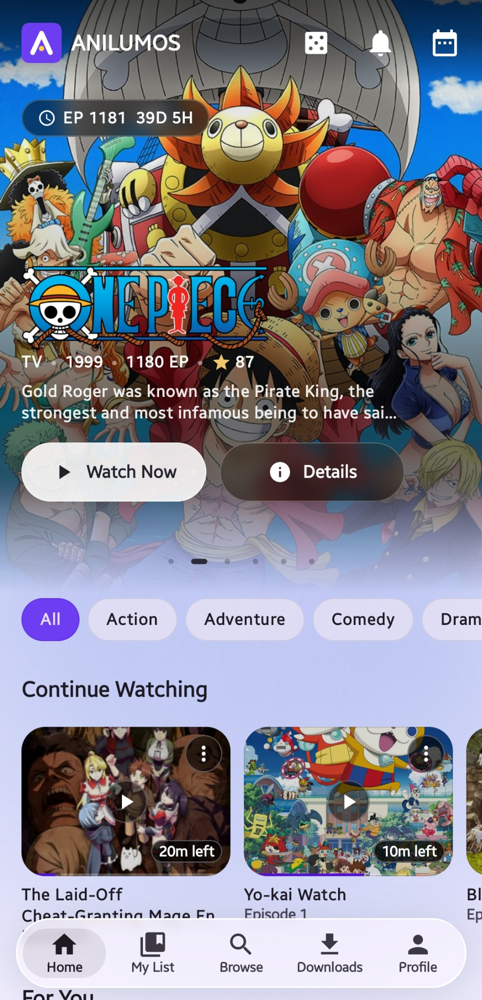
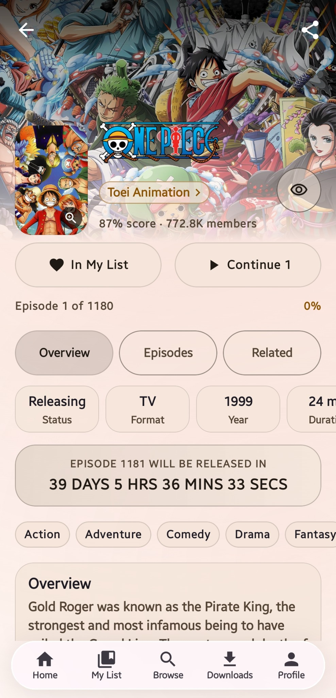
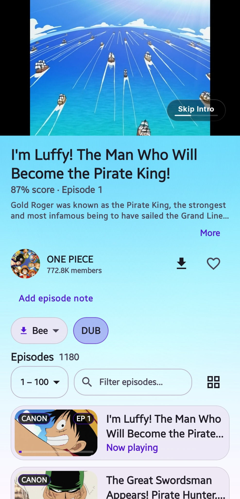
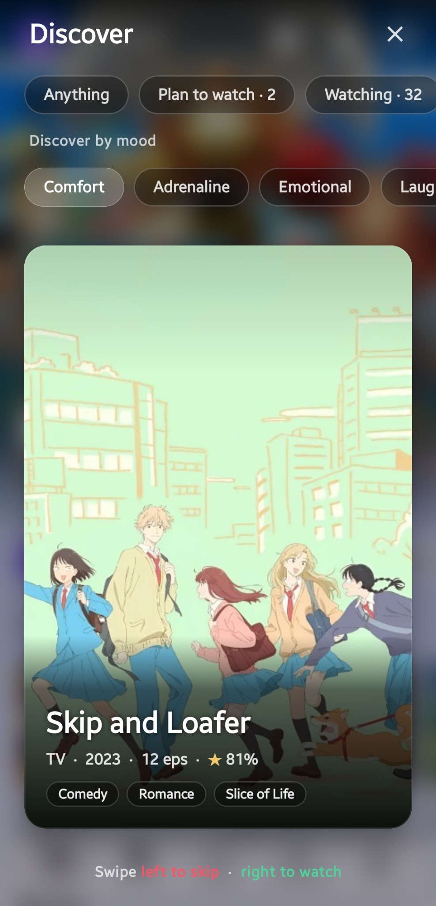
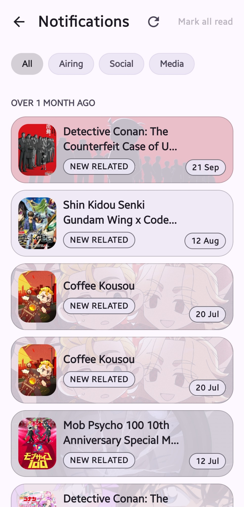
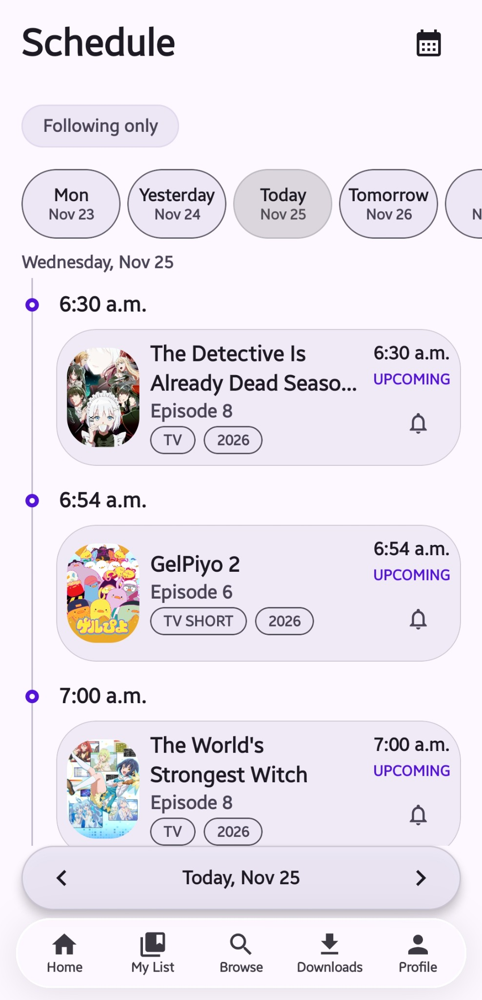
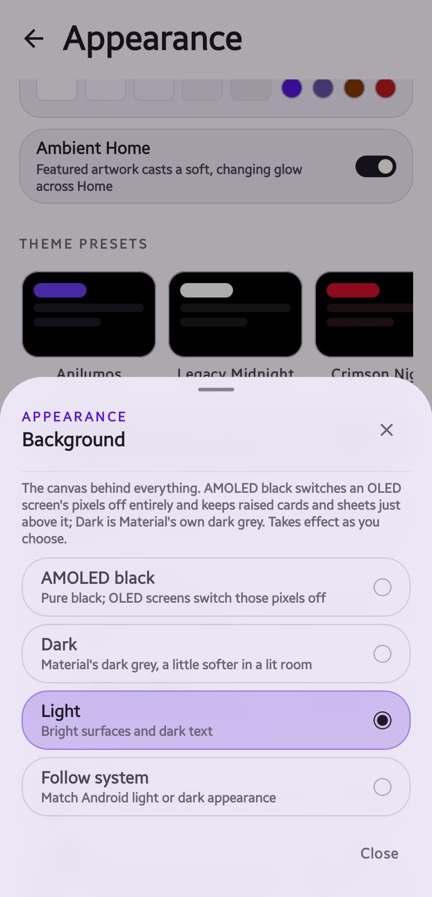
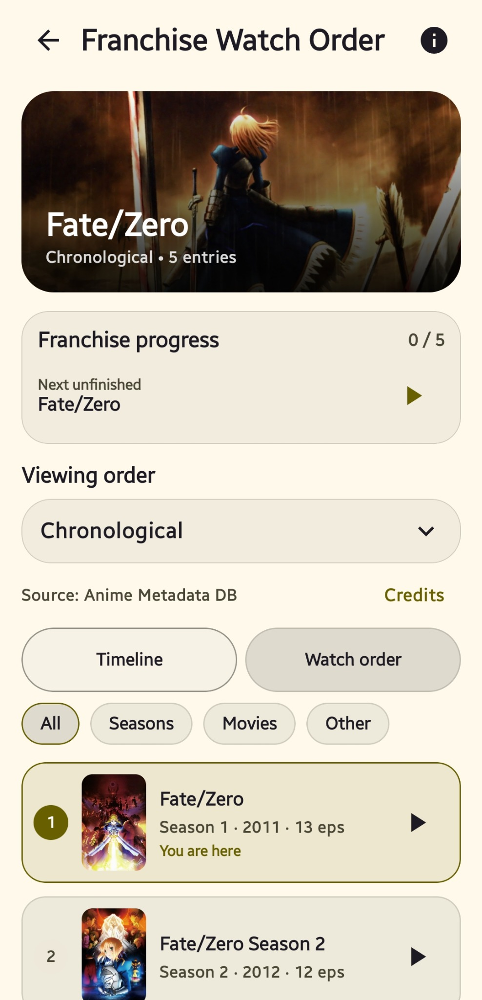

<div align="center">
  

  # AniLumos

  An anime app for Android phones and tablets, based on [AniLife](https://github.com/anilifecommunity/android-and-tv), with a redesigned Glass UI, personalised discovery and cinematic playback.

  [Download APK](https://github.com/vnxrgb/Anilumos/releases/latest) · [All releases](https://github.com/vnxrgb/Anilumos/releases) · [Report a bug](https://github.com/vnxrgb/Anilumos/issues)
</div>

<p align="center">
  <a href="https://github.com/vnxrgb/Anilumos/releases/latest"></a>
  <a href="https://github.com/vnxrgb/Anilumos/releases"></a>
  <a href="https://github.com/vnxrgb/Anilumos/stargazers"></a>
</p>

## About AniLumos

AniLumos builds on AniLife with its own visual identity, a redesigned interface and an emphasis on discovery, playback and everyday usability.

## Features

| Feature | What's included |
| --- | --- |
| **Glass UI** | Redesigned translucent navigation, cards, menus and controls, with glass material presets and light/dark themes. |
| **New branding** | Updated AniLumos logo, launcher icons, splash screen and theme-specific artwork. |
| **Discover** | Mood-based anime discovery, swipeable recommendations and a responsive landscape layout. |
| **Recommendations** | Improved personalised anime suggestions and community metadata. |
| **AniLumos Wrapped** | Anime viewing highlights and shareable artwork-based summaries. |
| **Cinematic player** | Ambient Cinema lighting, rounded playback controls, fullscreen and picture-in-picture support. |
| **Skip intro and outro** | Timed, dismissing skip controls when episode timestamps are available. |
| **Filler episodes** | Episode classification badges and optional filler filtering/skipping where metadata is available. |
| **Franchise Watch Order** | Release, chronological and community-curated viewing orders where available, with completion tracking and timeline or list views. |
| **Accounts and library** | AniList, MyAnimeList and Simkl integration, Discord Rich Presence, watch history and downloads. |
| **Adaptive layout** | Phone and tablet layouts, improved landscape navigation and readable status bars. |
| **Updates and diagnostics** | Direct in-app updates, metadata diagnostics and an in-app introduction to new features. |

Anime search, browsing, streaming sources, subtitles and external-player support are retained from AniLife. Availability of community metadata and connected services depends on the provider and title.

I've also set up a way to track streaming-provider changes from upstream. Those changes still need review and a new app release before they reach installed versions. More on that [here](docs/UPSTREAM_PROVIDER_SYNC.md).

## Screenshots

A look at AniLumos on Android, including Franchise Watch Order introduced in v2.0.2.

<p align="center">
  <a href="docs/store/screenshots/01-home.jpg"></a>
  <a href="docs/store/screenshots/02-anime-details.jpg"></a>
  <a href="docs/store/screenshots/03-player.jpg"></a>
  <a href="docs/store/screenshots/04-discover.jpg"></a>
</p>
<p align="center">Home and Glass UI · Anime details · Ambient player and Skip Intro · Mood-based Discover</p>

<p align="center">
  <a href="docs/store/screenshots/05-notifications.jpg"></a>
  <a href="docs/store/screenshots/06-schedule.jpg"></a>
  <a href="docs/store/screenshots/07-accounts.jpg"></a>
  <a href="docs/store/screenshots/08-appearance.jpg"></a>
</p>
<p align="center">Notifications · Airing schedule · Accounts and integrations · Appearance and themes</p>

### Franchise Watch Order

<p align="center">
  <a href="docs/store/screenshots/franchise-watch-order-entry.jpg"></a>
  <a href="docs/store/screenshots/franchise-watch-order-screen.jpg"></a>
</p>
<p align="center">Open the franchise guide from anime details · Explore chronological orders and track progress</p>

## Download

Grab the [latest stable APK](https://github.com/vnxrgb/Anilumos/releases/latest) from GitHub, or find the app on Orion Store.

<p align="center">
  <a href="https://rookieenough.github.io/Orion-Data/app/?id=anilumos"></a>
</p>

The stable app uses `com.anilumos.app`. Some signed preview builds use the same package and may replace an installed stable build; check the release notes before installing. AniLife keeps its own app data.

Stable releases are intended for Android phones and tablets. Android TV builds are experimental and are not part of this stable mobile release.

## Building it yourself

You'll need JDK 17, Android SDK 36 and the Gradle wrapper included in this repository.

```bash
./gradlew :app:testMobileDebugUnitTest :app:lintMobileDebug :app:assembleMobileDebug
```

## Credits and licenses

**Anilumos is a fork, not an app built from scratch.** Most of the underlying functionality comes from [AniLife](https://github.com/anilifecommunity/android-and-tv), and credit for that belongs to the [AniLife contributors](https://github.com/anilifecommunity/android-and-tv/graphs/contributors).

Ambient lighting uses adapted code from [Morphe](https://github.com/MorpheApp/morphe-patches). You can read the [implementation notes](docs/MORPHE_AMBIENT_PORT.md).

Other libraries used in the app include [AndroidX / Jetpack Compose / Media3](https://github.com/androidx/androidx), [Haze](https://github.com/chrisbanes/haze), [Coil](https://github.com/coil-kt/coil), [OkHttp](https://github.com/square/okhttp), [Okio](https://github.com/square/okio), [MaterialKolor](https://github.com/jordond/MaterialKolor), and [Nayuki's QR Code generator](https://github.com/nayuki/QR-Code-generator).

**Required Morphe notice:**

> This app uses code from Morphe. To learn more, visit https://morphe.software

The [AniLife Source-Available License 1.0](LICENSE) is retained. Redistribution of modified AniLife code requires permission; the maintainer has stated that permission was obtained. Morphe-derived code has separate [GPLv3](app/src/main/assets/GPL-3.0.txt) obligations and a [required notice](app/src/main/assets/MORPHE_NOTICE.txt). See [asset licenses](docs/ASSET-LICENCES.md) for additional details.

Anilumos isn't affiliated with or endorsed by AniLife or Morphe. It doesn't host anime streams or own third-party content.

---

[Privacy](PRIVACY.md) · [Security](SECURITY.md) · [Support](SUPPORT.md)


### Original AniLumos contributions

Copyright © 2026 [vnxrgb](https://github.com/vnxrgb).

This notice applies only to original contributions owned by the AniLumos maintainer, such as independently created branding, visual assets, UI work, and code changes. It does not claim ownership of underlying AniLife code, Morphe-derived work, or third-party materials. Their existing licenses, attribution requirements, and permissions remain in effect.

### Community playback metadata

- [Tenrai](https://tenrai.org/) — unofficial public MAL episode flags and community recommendations, using its documented v1 API. Replaces the discontinued public Jikan API. No API key is embedded; public request limits and cooldowns are respected. See [Tenrai terms](https://tenrai.org/terms).

- [AniSkip](https://github.com/aniskip/aniskip-api) — anime intro, ending and recap timestamps.
- [TheIntroDB](https://theintrodb.org/) — community segment timestamps.
- [IntroDB](https://introdb.app/) — community segment timestamps, [ODbL 1.0 open data](https://api.introdb.app/open-data/).
- Anime filler data from [FillerLists and its sources](https://fillerlists.com/data), [CC BY-SA 4.0](https://creativecommons.org/licenses/by-sa/4.0/). The app retains episode numbers and explicit classifications (filler, canon, mixed and anime canon), with the source data available under the same CC BY-SA 4.0 license.
- [AniFillerPedia](https://anifillerpedia.wiki/) — cited episode classifications for non-commercial use under its [data license](https://anifillerpedia.wiki/api/v1/license). Explicit episode classifications are cached for non-commercial use; the original data and its licensing terms remain available at the source.

These optional read-only providers need no user credentials. Unknown or mixed episodes are not treated as filler merely because a lookup returned no classification.
