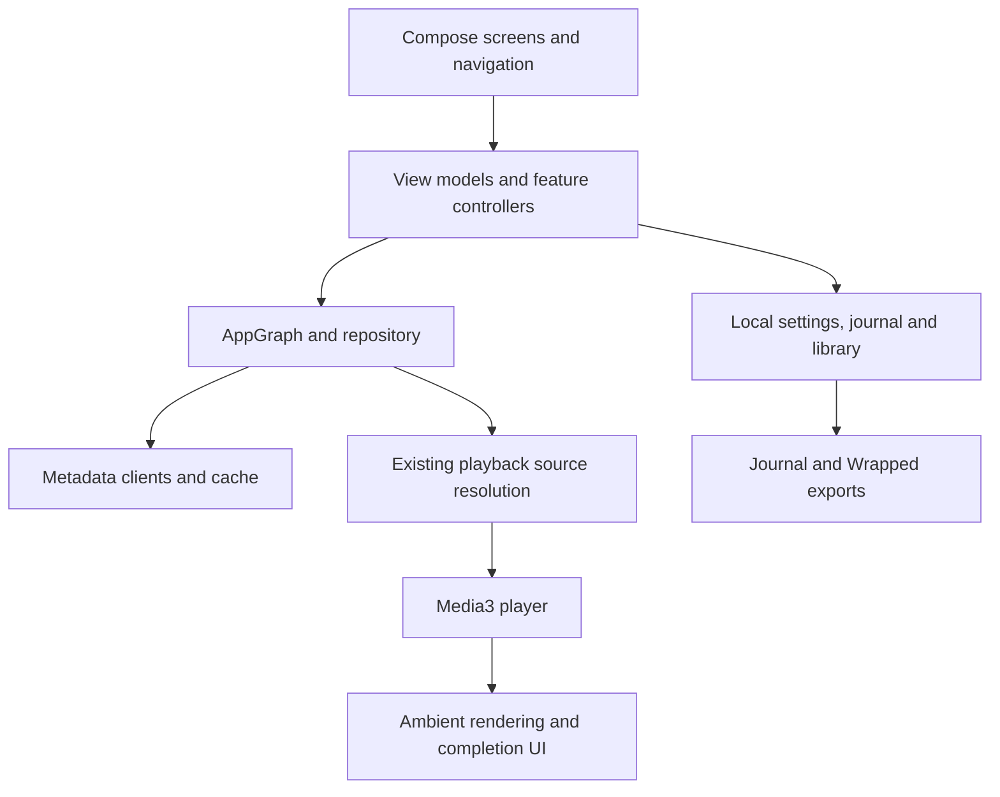

# AniLumos technical documentation

AniLumos is an Android anime companion built on AniLife, with original features and integrations developed in this fork. This guide explains the implementation, not just the feature list.

**Baseline:** [main at `6ebaead`](https://github.com/vnxrgb/Anilumos/tree/6ebaead4093a31b76a40bef0718827ca8b48167b). Stable mobile is the focus; this is a source audit, not a claim of fresh runtime testing.

## Developer reading map

| Guide | Contents |
| --- | --- |
| [Original features](FEATURE_IMPLEMENTATIONS.md) | Afterglow, Anime Journal, Wrapped, mood discovery, franchise guides, recommendations, personalization and Hidden Sparks |
| [Interface and cinematic playback](UI_AND_PLAYBACK.md) | Optical glass, ambient artwork and video, responsive layouts, skip controls and Up Next |
| [Data, integrations and releases](DATA_AND_RELEASES.md) | Metadata APIs, cache, diagnostics, inherited infrastructure, update security, website, validation and release boundaries |
| [Contribution and license map](CONTRIBUTION_MAP.md) | Original implementation boundaries, adapted work, inherited functionality and attribution |

## Architecture in brief

The diagram is a conceptual dependency map, not a complete runtime call graph. Entry points: [MainActivity.kt](../app/src/main/java/com/anilili/MainActivity.kt) · [AppGraph.kt](../app/src/main/java/com/anilili/data/AppGraph.kt) · [MiruroRepository.kt](../app/src/main/java/com/anilili/data/MiruroRepository.kt) · [SettingsStore.kt](../app/src/main/java/com/anilili/data/settings/SettingsStore.kt) · [LibraryStore.kt](../app/src/main/java/com/anilili/data/library/LibraryStore.kt) · [WatchViewModel.kt](../app/src/main/java/com/anilili/ui/watch/WatchViewModel.kt).

## Existing operational references

- [Compatibility](COMPATIBILITY.md), [configuration](CONFIGURATION.md), [diagnostics](DIAGNOSTICS.md), [error codes](ERROR_CODES.md).
- [Upstream provider synchronization](UPSTREAM_PROVIDER_SYNC.md), [TV pairing protocol](TV_PAIRING_PROTOCOL.md).
- [Release runbook](release/runbook.md), [security incident response](security/incident-response.md).
- [Morphe ambient port](MORPHE_AMBIENT_PORT.md), [asset provenance](ASSET-LICENCES.md), [ownership](OWNERSHIP.md), [copyright and license scope](../COPYRIGHT.md).

## Documentation scope

This guide covers only code and documentation present on the inspected main revision. It does not describe unmerged features or development branches.

When changing a feature, update its guide, identify the source files and licenses, and record relevant tests and known limitations. Avoid describing planned features as implemented.
