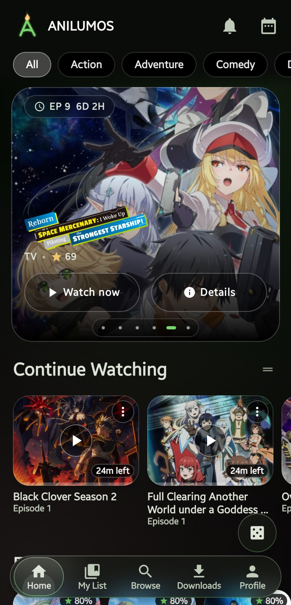
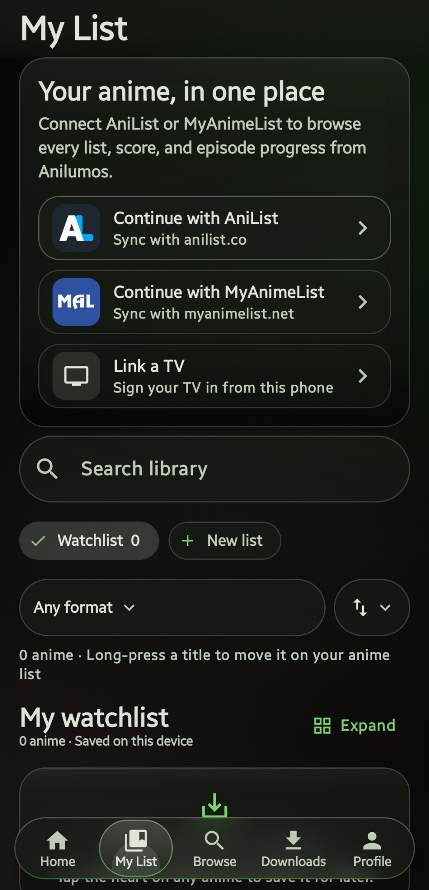
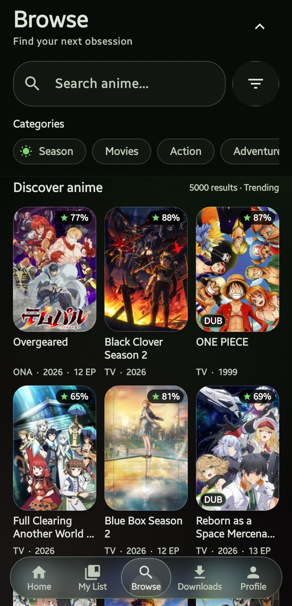
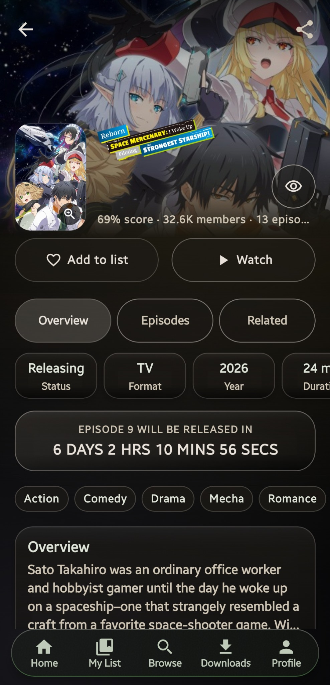
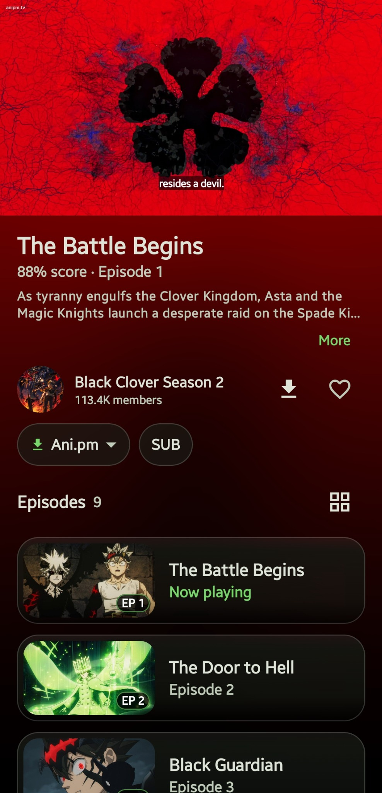

# Anilumos Store Screenshots

Original, unedited Android screenshots for store submissions, including Orion Store.

All screenshots are portrait JPEGs at **988 × 2048 px**. Open the direct image links below, or copy the URLs into the store submission form. The files are kept outside `app/src/main/res` and are not bundled into the APK.

| Preview | Screen | Direct image |
|---|---|---|
|  | Home and Continue Watching | [Open original JPEG](https://raw.githubusercontent.com/vnxrgb/Anilumos/main/docs/store/screenshots/01-home.jpg) |
|  | My List and account connections | [Open original JPEG](https://raw.githubusercontent.com/vnxrgb/Anilumos/main/docs/store/screenshots/02-my-list.jpg) |
|  | Browse and discover anime | [Open original JPEG](https://raw.githubusercontent.com/vnxrgb/Anilumos/main/docs/store/screenshots/03-browse.jpg) |
|  | Anime details and episode countdown | [Open original JPEG](https://raw.githubusercontent.com/vnxrgb/Anilumos/main/docs/store/screenshots/04-anime-details.jpg) |
|  | Episode playback and ambient lighting | [Open original JPEG](https://raw.githubusercontent.com/vnxrgb/Anilumos/main/docs/store/screenshots/05-episode-playback.jpg) |

**App icon:** [512 × 512 Anilumos PNG](https://raw.githubusercontent.com/vnxrgb/Anilumos/main/app/src/main/res/drawable-nodpi/anilumos_store_icon.png).
